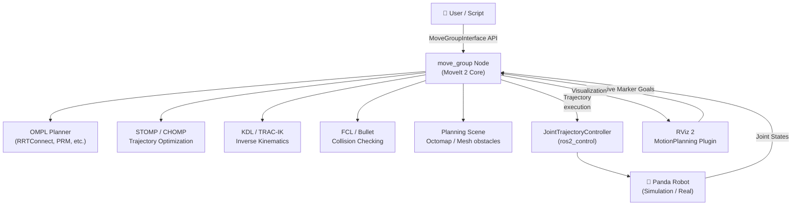

# 🤖 MoveIt 2 + Panda Robot — Complete Teaching Repository

> **ROS 2 Jazzy Jalisco** | Branch: `jazzy`  
> For ROS 2 Humble (LTS), switch to the [`humble`](../../tree/humble) branch.

[](https://docs.ros.org/en/jazzy/)
[](https://moveit.ros.org/)
[](LICENSE)
[](https://www.python.org/)
[](https://isocpp.org/)

---

## 📚 About This Repository

This repository is a **comprehensive, hands-on course** for learning MoveIt 2 motion planning with the Franka Panda 7-DOF robot arm in RViz. It is structured for university students and robotics enthusiasts with:

- 📦 Ready-to-run ROS 2 packages (Python & C++)
- 🗺️ Visual architecture diagrams and motion planning flowcharts
- 📷 Annotated RViz screenshots for every exercise
- 🧩 Progressive lessons from installation to advanced pick & place
- 📊 Benchmark graphs of planning time vs. algorithms

---

## 🗂️ Repository Structure

```
panda_moveit2_tutorial/
├── README.md                          # You are here
├── docs/                              # 📖 Lesson files (Wiki-style)
│   ├── 00_overview.md                 # MoveIt 2 architecture overview
│   ├── 01_installation.md             # Installation guide (Humble)
│   ├── 02_rviz_basics.md              # RViz & MoveIt plugin tour
│   ├── 03_motion_planning_python.md   # Python motion planning tutorial
│   ├── 04_motion_planning_cpp.md      # C++ motion planning tutorial
│   ├── 05_constraints.md              # Joint & Cartesian constraints
│   ├── 06_pick_and_place.md           # Pick & place pipeline
│   ├── 07_custom_planners.md          # Custom planner integration
│   └── images/                        # Screenshots & diagrams
└── src/
    ├── panda_moveit2_tutorials/       # Python ROS 2 package
    │   ├── panda_moveit2_tutorials/   # Python nodes
    │   ├── scripts/                   # Standalone scripts
    │   ├── launch/                    # Launch files
    │   ├── config/                    # YAML configs
    │   ├── package.xml
    │   └── setup.py
    └── panda_moveit2_cpp/             # C++ ROS 2 package
        ├── src/                       # C++ source files
        ├── include/                   # C++ headers
        ├── CMakeLists.txt
        └── package.xml
```

---

## 🧠 MoveIt 2 Architecture Overview



---

## 🏗️ Motion Planning Pipeline


---

## 🚀 5-Minute Student Sandbox (Try It Now!)

Want to test motion planning immediately before reading the code?

```bash
# 1. Launch Panda in RViz 2
ros2 launch moveit_resources_panda_moveit_config demo.launch.py

# 2. In RViz:
#    a. Locate the "MotionPlanning" panel on the left.
#    b. Change "Goal State" to "ready".
#    c. Click "Plan & Execute" — watch the Panda arm glide into position!
```

---

## ⚡ Quick Start

### Prerequisites
- Ubuntu 24.04 (or WSL2 with Ubuntu 24.04)
- ROS 2 Jazzy Jalisco (see [Installation Guide](docs/01_installation.md))

### 1. Install Dependencies

```bash
sudo apt update && sudo apt install -y \
  ros-jazzy-moveit \
  ros-jazzy-moveit-ros-planning-interface \
  ros-jazzy-franka-ros2 \
  ros-jazzy-ros2-control \
  ros-jazzy-ros2-controllers
```

### 2. Clone & Build

```bash
mkdir -p ~/ros2_ws/src && cd ~/ros2_ws/src
git clone -b jazzy https://github.com/JosiahSK/panda_moveit2_tutorial.git
cd ~/ros2_ws
rosdep install --from-paths src --ignore-src -r -y
colcon build --symlink-install
source install/setup.bash
```

### 3. Launch Panda in RViz

```bash
# Launch the MoveIt demo with the Panda robot
ros2 launch moveit_resources_panda_moveit_config demo.launch.py
```

### 4. Run a Python Motion Planning Example

```bash
ros2 run panda_moveit2_tutorials basic_motion_planner
```

### 5. Run a C++ Motion Planning Example

```bash
ros2 run panda_moveit2_cpp basic_motion_planner_cpp
```

---

## 📖 Lesson Index

| # | Lesson | Topic | Difficulty |
|---|--------|-------|------------|
| 00 | [Overview](docs/00_overview.md) | MoveIt 2 architecture, concepts | 🟢 Beginner |
| 01 | [Installation](docs/01_installation.md) | Full setup guide for Humble | 🟢 Beginner |
| 02 | [RViz Basics](docs/02_rviz_basics.md) | MoveIt plugin, interactive markers | 🟢 Beginner |
| 03 | [Python Planning](docs/03_motion_planning_python.md) | MoveGroupInterface in Python | 🟡 Intermediate |
| 04 | [C++ Planning](docs/04_motion_planning_cpp.md) | MoveGroupInterface in C++ | 🟡 Intermediate |
| 05 | [Constraints](docs/05_constraints.md) | Joint & path constraints | 🟡 Intermediate |
| 06 | [Pick & Place](docs/06_pick_and_place.md) | Full grasp pipeline | 🔴 Advanced |
| 07 | [Custom Planners](docs/07_custom_planners.md) | Swap planners, tune parameters | 🔴 Advanced |

---

## 🔀 Branch Comparison

| Feature | `humble` branch | `jazzy` branch |
|---------|----------------|----------------|
| ROS 2 Version | Humble Hawksbill (LTS) | **Jazzy Jalisco** ← **(you are here)** |
| Ubuntu | 22.04 LTS | **24.04 LTS** |
| MoveIt 2 | 2.5.x | **2.8.x** |
| Python | 3.10 | **3.12** |
| Key Differences | Classic `moveit_resources` API | **New `moveit_configs_utils` API** |
| Status | ✅ Supported until May 2027 | ✅ **Active Development** |

---

## 🤝 Contributing

Pull requests are welcome! Please open an issue first to discuss what you'd like to change.

## 📜 License

MIT License — see [LICENSE](LICENSE)

## 🙏 Acknowledgements

- [MoveIt 2 Official Documentation](https://moveit.ros.org/)
- [Franka Robotics](https://www.franka.de/)
- [JosiahSK/Panda_Moveit2](https://github.com/JosiahSK/Panda_Moveit2) — reference repo
- [Open Source Robotics Foundation](https://www.openrobotics.org/)
