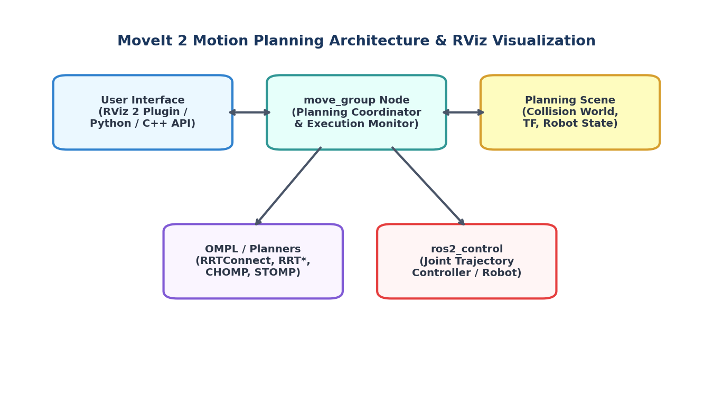
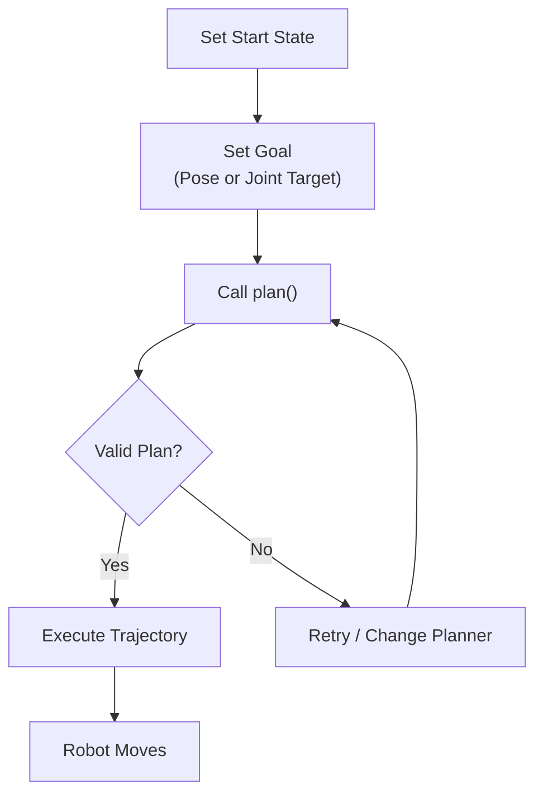

# Lesson 00 — MoveIt 2 Architecture Overview

> **Branch:** `humble` | ROS 2 Humble Hawksbill

---

## What is MoveIt 2?

**MoveIt 2** is the premier motion planning framework for ROS 2. It provides:

- **Motion planning** — compute collision-free joint trajectories
- **Kinematics** — forward and inverse kinematics solvers
- **Collision checking** — real-time environment awareness
- **Trajectory execution** — send commands to real or simulated robots
- **Perception integration** — process point clouds and depth images



---

## 🐣 Beginner's Mental Model & Glossary

If you are new to robotics and MoveIt, here are 5 foundational concepts simplified:

| Concept | What It Is In Plain English | Why It Matters |
|---|---|---|
| **URDF** | The robot's biological skeleton (links, joints, 3D meshes, collision boundaries). | Tells MoveIt where the joints bend and how long each arm segment is. |
| **SRDF** | The robot's rulebook (groups named `panda_arm`, predefined poses like `ready`, collision exemptions). | Speeds up collision checking by ignoring links that always touch (like joint 1 & 2). |
| **End-Effector (EEF)** | The robot's hand or fingertip (`panda_hand` or `panda_link8`). | You usually specify *where the hand should go in 3D space*, not each joint angle. |
| **Inverse Kinematics (IK)** | The mathematical equation that solves: *"To put the hand at (X, Y, Z), which angle should each of the 7 motors turn?"* | Solves coordinate goals into actual motor commands. |
| **Planning vs. Execution** | **Planning** simulates and checks the path for collisions. **Execution** actually sends electrical signals to the robot motors. | You can safely test trajectories in RViz before risking physical hardware! |

---

## Key Concepts

### 1. Planning Scene 🗺️

The Planning Scene is MoveIt's representation of the world. It contains:

- The **robot model** (URDF/SRDF)
- **Collision objects** (boxes, spheres, meshes)
- **Attached objects** (objects the robot is holding)
- **Octomap** (from depth sensor point cloud)

```
Planning Scene
├── Robot State (joint positions)
├── World
│   ├── Collision Objects
│   └── Octomap
└── Attached Objects
```

### 2. MoveGroup Interface 🖥️

The primary API you'll use as a developer. It wraps the `move_group` ROS node:

```python
from moveit.planning import MoveItPy

moveit = MoveItPy(node_name="my_robot_planner")
panda_arm = moveit.get_planning_component("panda_arm")
```

### 3. Planning Pipeline ⚙️



### 4. OMPL Planners 📐

MoveIt 2 ships with OMPL (Open Motion Planning Library) planners:

| Planner | Type | Best For |
|---------|------|----------|
| **RRTConnect** | Sampling | General purpose, fast |
| **RRT*** | Sampling | Optimal, slower |
| **PRM** | Roadmap | Repetitive tasks in static scenes |
| **LBKPIECE1** | Sampling | High-dimensional spaces |
| **CHOMP** | Optimization | Smooth trajectories |
| **STOMP** | Stochastic | Noisy, non-smooth cost functions |

### 5. SRDF — Semantic Robot Description Format

The SRDF complements the URDF with semantic information:

```xml
<group name="panda_arm">
  <joint name="panda_joint1" />
  <joint name="panda_joint2" />
  <!-- ... 7 joints total -->
</group>

<group_state name="ready" group="panda_arm">
  <joint name="panda_joint1" value="0" />
  <!-- named configuration -->
</group_state>

<disable_collisions link1="panda_link0" link2="panda_link1" reason="Adjacent" />
```

---

## Panda Robot Anatomy

The Franka Panda has **7 revolute joints** and **1 prismatic gripper**:

```
panda_link0 (base)
    └─ panda_joint1 (revolute, Z-axis)
       └─ panda_link1
          └─ panda_joint2 (revolute, Y-axis)
             └─ panda_link2
                └─ panda_joint3 (revolute, Z-axis)
                   └─ panda_link3
                      └─ panda_joint4 (revolute, Y-axis, -π to 0)
                         └─ panda_link4
                            └─ panda_joint5 (revolute, Z-axis)
                               └─ panda_link5
                                  └─ panda_joint6 (revolute, Y-axis)
                                     └─ panda_link6
                                        └─ panda_joint7 (revolute, Z-axis)
                                           └─ panda_link7
                                              └─ panda_hand
                                                 ├─ panda_finger_joint1
                                                 └─ panda_finger_joint2
```

### Joint Limits

| Joint | Min (rad) | Max (rad) | Max Velocity (rad/s) |
|-------|-----------|-----------|----------------------|
| joint1 | -2.8973 | 2.8973 | 2.175 |
| joint2 | -1.7628 | 1.7628 | 2.175 |
| joint3 | -2.8973 | 2.8973 | 2.175 |
| joint4 | -3.0718 | -0.0698 | 2.175 |
| joint5 | -2.8973 | 2.8973 | 2.610 |
| joint6 | -0.0175 | 3.7525 | 2.610 |
| joint7 | -2.8973 | 2.8973 | 2.610 |

---

## Next Steps

👉 Proceed to [Lesson 01 — Installation](01_installation.md)
