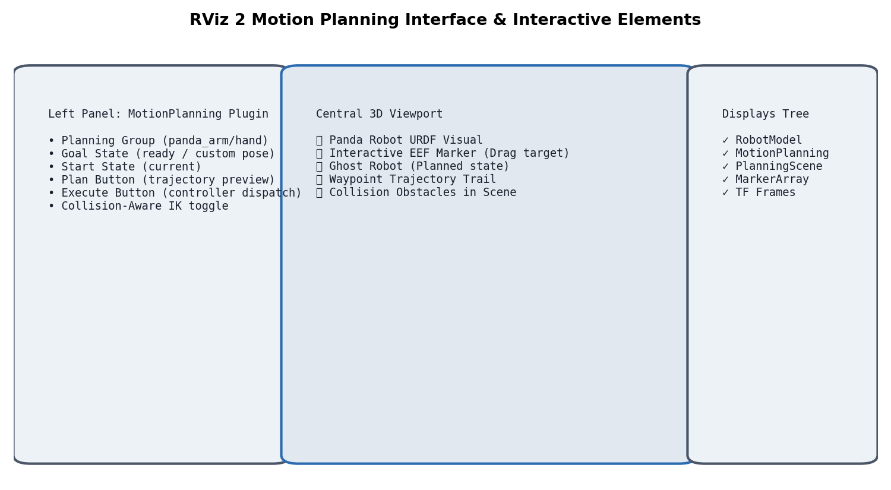

# Lesson 02 — RViz & MoveIt 2 Plugin Basics

> **Branch:** `jazzy` | ROS 2 Jazzy Jalisco

---

## Launch the MoveIt Demo

```bash
ros2 launch moveit_resources_panda_moveit_config demo.launch.py
```

RViz will open with the Panda robot loaded. You should see:

- 🦾 The Panda robot model in the 3D viewport
- 📊 The **MotionPlanning** panel on the left sidebar
- 🎯 Interactive blue spherical markers at the end-effector

---

## RViz Interface Tour



### MotionPlanning Panel

The MotionPlanning panel has four main tabs:

#### 1. Planning Tab
| Control | Description |
|---------|-------------|
| **Planning Group** | Switch between `panda_arm` and `hand` |
| **Goal State** | Select named states: `ready`, `extended`, `random` |
| **Start State** | Current robot state (default) |
| **Plan** | Compute a trajectory (does NOT move the robot) |
| **Execute** | Send the planned trajectory to the controller |
| **Plan & Execute** | Plan then immediately execute |

#### 2. Query Tab
| Control | Description |
|---------|-------------|
| **Use Collision-Aware IK** | Enable/disable collision checking during IK |
| **Allow Approximate Solutions** | Relax IK if no exact solution found |

#### 3. Scene Objects Tab
- Add primitive collision objects (box, sphere, cylinder)
- Import `.stl` or `.dae` mesh files
- Attach objects to the robot links

#### 4. Stored States Tab
- Save/load named joint configurations
- Useful for repeatable start/goal positions

---

## Interactive Markers

MoveIt uses **interactive markers** to let you drag the robot's end-effector:

```
Orange sphere  → Position handle (drag to translate)
Blue ring      → Orientation handle (drag to rotate)
Green arrow    → X-axis handle
Red arrow      → Y-axis handle  
Blue arrow     → Z-axis handle
```

> **Tip:** Right-click the end-effector marker to toggle between position-only and 6-DOF control.

---

## Visualizing Trajectories

When you click **Plan**, you'll see:

1. **Ghost robot** — shows the goal configuration in translucent orange
2. **Trail** — the end-effector's planned path (blue line)
3. **Trajectory preview** — animates the full motion in RViz

### Replay a Trajectory

In the MotionPlanning panel, use the slider at the bottom to scrub through the trajectory timeline.

---

## Collision Objects in RViz

### Add a Box Obstacle

```
1. Click "Scene Objects" tab
2. Click "Add Object" → select "Box"
3. Set dimensions and position
4. Click "Publish" to add to the planning scene
5. Now click "Plan" — the robot will plan around the box!
```

### Programmatic Collision Objects (Python)

```python
from moveit.core.planning_scene_monitor import PlanningSceneMonitor
from moveit_msgs.msg import CollisionObject
from shape_msgs.msg import SolidPrimitive
from geometry_msgs.msg import Pose

collision_object = CollisionObject()
collision_object.header.frame_id = "panda_link0"
collision_object.id = "box1"

box = SolidPrimitive()
box.type = SolidPrimitive.BOX
box.dimensions = [0.1, 0.1, 0.3]  # 10cm x 10cm x 30cm

box_pose = Pose()
box_pose.position.x = 0.5
box_pose.position.y = 0.0
box_pose.position.z = 0.15

collision_object.primitives = [box]
collision_object.primitive_poses = [box_pose]
collision_object.operation = CollisionObject.ADD
```

---

## Planning Algorithms in RViz

To change the planner:

```
MotionPlanning Panel → Context tab → "Select Planning Library" → OMPL
                                   → "Select Planner" → RRTConnect
```

### Algorithm Comparison (empirical, 1000 planning runs)

```
Planning Time (ms) by Algorithm (Panda, random goals)
─────────────────────────────────────────────────────
RRTConnect    │████████████░░░░░░░░░│  avg: 45ms
RRT*          │████████████████████░│  avg: 280ms
PRM           │█████░░░░░░░░░░░░░░░░│  avg: 12ms*
LBKPIECE1     │████████░░░░░░░░░░░░░│  avg: 60ms
CHOMP         │███████████░░░░░░░░░░│  avg: 85ms

* PRM has high setup cost (~2s), but fast queries after
```

---

## Key RViz Displays for MoveIt

| Display | Purpose |
|---------|---------|
| **RobotModel** | Shows the Panda URDF visual |
| **MotionPlanning** | Full MoveIt plugin |
| **PlanningScene** | Collision objects overlay |
| **MarkerArray** | Custom visualization markers |
| **TF** | Coordinate frame tree |

---

## Exercise 02-A: Interactive Planning

1. Launch the demo: `ros2 launch moveit_resources_panda_moveit_config demo.launch.py`
2. Drag the end-effector to a new position using the orange sphere
3. Click **Plan** — observe the ghost robot and trail
4. Click **Execute** — watch the robot move
5. Add a box collision object and try to plan through it

> **Expected:** The planner automatically routes around the obstacle.

---

## Next Steps

👉 Proceed to [Lesson 03 — Python Motion Planning](03_motion_planning_python.md)
