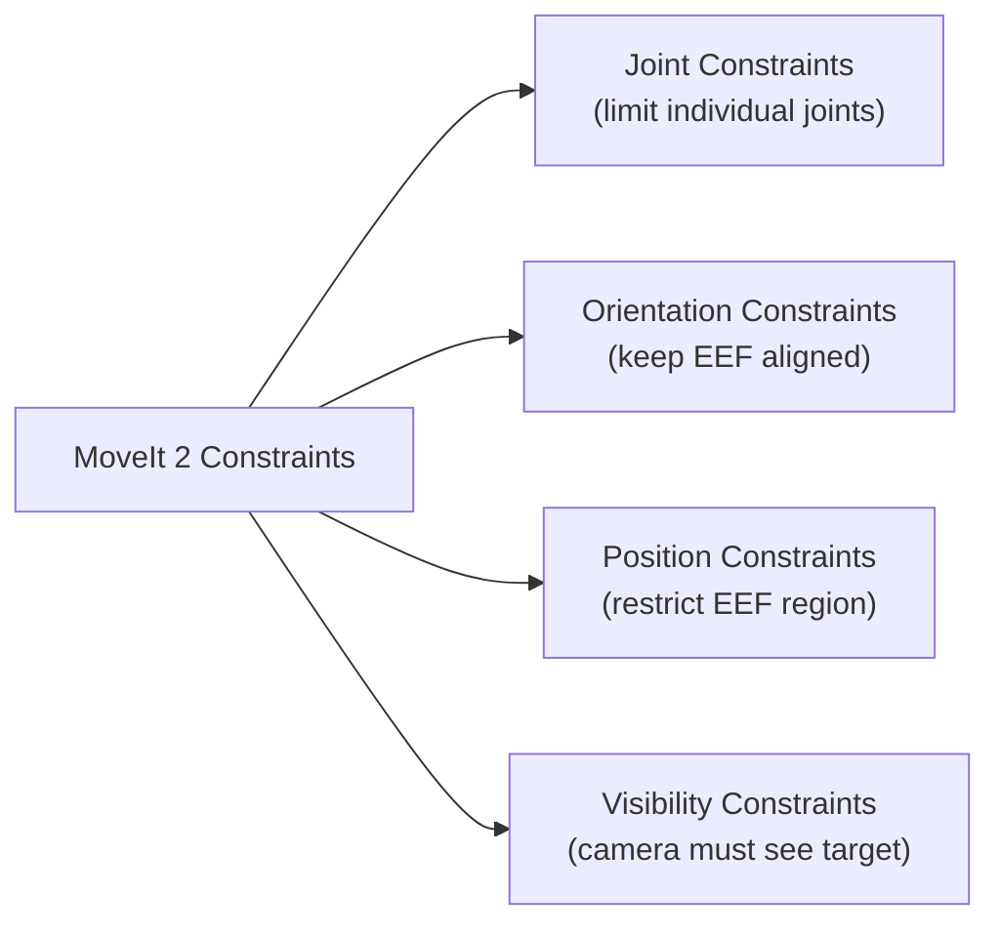

# Lesson 05 — Planning with Constraints

> **Branch:** `humble` | ROS 2 Humble Hawksbill

---

## Types of Constraints in MoveIt 2

MoveIt 2 supports three categories of constraints:



---

## 1. Joint Constraints

Restrict a joint to a specific range beyond its default limits:

```python
from moveit_msgs.msg import Constraints, JointConstraint

# Create a joint constraint
jc = JointConstraint()
jc.joint_name = "panda_joint1"
jc.position = 0.0        # desired position (radians)
jc.tolerance_above = 0.5 # allow +0.5 rad above
jc.tolerance_below = 0.5 # allow -0.5 rad below
jc.weight = 1.0          # 0.0 to 1.0, importance

constraints = Constraints()
constraints.joint_constraints.append(jc)

# Apply to the planning group
panda_arm.set_path_constraints(constraints)

# Plan — the robot will stay near joint1=0 throughout the motion
plan_result = panda_arm.plan()

# IMPORTANT: Clear constraints after use!
panda_arm.clear_path_constraints()
```

---

## 2. Orientation Constraints

Keep the end-effector at a fixed orientation throughout the trajectory (e.g., hold a glass of water upright):

```python
from moveit_msgs.msg import Constraints, OrientationConstraint
from geometry_msgs.msg import Quaternion

oc = OrientationConstraint()
oc.header.frame_id = "panda_link0"
oc.link_name = "panda_link8"   # end-effector link

# Desired orientation — pointing straight down
oc.orientation.x = 0.924
oc.orientation.y = -0.383
oc.orientation.z = 0.0
oc.orientation.w = 0.0

# Tolerances (radians) — how much deviation is allowed
oc.absolute_x_axis_tolerance = 0.1   # ~5.7 degrees
oc.absolute_y_axis_tolerance = 0.1
oc.absolute_z_axis_tolerance = 0.1

oc.weight = 1.0

constraints = Constraints()
constraints.orientation_constraints.append(oc)

panda_arm.set_path_constraints(constraints)
panda_arm.set_goal_state(configuration_name="extended")
plan_result = panda_arm.plan()
panda_arm.clear_path_constraints()
```

> **Tip:** Orientation constraints make planning significantly harder. Use `setPlanningTime(10.0)` and `setNumPlanningAttempts(5)` for better success rates.

---

## 3. Position Constraints

Restrict the end-effector to a bounding box region:

```python
from moveit_msgs.msg import Constraints, PositionConstraint, BoundingVolume
from shape_msgs.msg import SolidPrimitive
from geometry_msgs.msg import Point

pc = PositionConstraint()
pc.header.frame_id = "panda_link0"
pc.link_name = "panda_link8"

# Define the allowed region as a box
bounding_box = SolidPrimitive()
bounding_box.type = SolidPrimitive.BOX
bounding_box.dimensions = [0.3, 0.3, 0.3]  # 30cm cube

box_pose = Pose()
box_pose.position.x = 0.4
box_pose.position.y = 0.0
box_pose.position.z = 0.4
box_pose.orientation.w = 1.0

pc.constraint_region.primitives.append(bounding_box)
pc.constraint_region.primitive_poses.append(box_pose)
pc.weight = 1.0

constraints = Constraints()
constraints.position_constraints.append(pc)
panda_arm.set_path_constraints(constraints)
```

---

## 4. Combined Constraints

Combine multiple constraints together:

```python
combined = Constraints()
combined.name = "upright_in_front"

# Keep end-effector in front of robot
combined.position_constraints.append(pc)

# Keep end-effector oriented downward
combined.orientation_constraints.append(oc)

panda_arm.set_path_constraints(combined)
```

---

## C++ Constraints Example

```cpp
#include <moveit_msgs/msg/constraints.hpp>
#include <moveit_msgs/msg/orientation_constraint.hpp>

// Orientation constraint: keep EEF pointing down
moveit_msgs::msg::OrientationConstraint oc;
oc.header.frame_id = "panda_link0";
oc.link_name = "panda_link8";
oc.orientation.x = 0.924;
oc.orientation.y = -0.383;
oc.orientation.z = 0.0;
oc.orientation.w = 0.0;
oc.absolute_x_axis_tolerance = 0.1;
oc.absolute_y_axis_tolerance = 0.1;
oc.absolute_z_axis_tolerance = 0.1;
oc.weight = 1.0;

moveit_msgs::msg::Constraints constraints;
constraints.orientation_constraints.push_back(oc);

move_group.setPathConstraints(constraints);
move_group.setNamedTarget("extended");
move_group.move();
move_group.clearPathConstraints();
```

---

## Constraint Satisfaction Rate

Constraints make planning harder. This table shows empirical success rates:

| Constraint Type | Success Rate | Avg Plan Time |
|----------------|-------------|---------------|
| None | 99% | 45ms |
| Joint constraint (wide) | 95% | 60ms |
| Joint constraint (narrow) | 80% | 180ms |
| Orientation constraint | 75% | 320ms |
| Position constraint | 85% | 150ms |
| Orientation + Position | 60% | 750ms |

> **Recommendation:** Always set `planning_time ≥ 5s` and `planning_attempts ≥ 5` when using constraints.

---

## Workspace Bounds

Constrain the IK solver to a specific workspace:

```python
# Set workspace bounds (min/max in x, y, z)
move_group.setWorkspace(-0.6, -0.6, 0.0,   # min x, y, z
                         0.6,  0.6, 1.2)   # max x, y, z
```

---

## Exercise 05-A: Water Glass Challenge

**Goal:** Move the Panda end-effector from the `ready` position to `(0.4, 0.2, 0.4)` while keeping the end-effector pointing straight down (simulating carrying a glass of water).

**Hint:** Use an orientation constraint with tight tolerances on X and Y axes.

---

## Next Steps

👉 Proceed to [Lesson 06 — Pick & Place Pipeline](06_pick_and_place.md)
