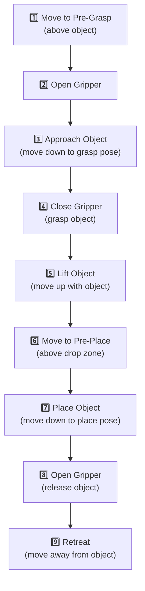

# Lesson 06 — Pick & Place Pipeline

> **Branch:** `jazzy` | ROS 2 Jazzy Jalisco

---

## Overview

A complete pick and place task consists of 8 stages:



---

## Scene Setup

First, add a table surface and a target object:

```python
from moveit_msgs.msg import CollisionObject
from shape_msgs.msg import SolidPrimitive
from geometry_msgs.msg import Pose

def add_scene_objects(planning_scene_monitor):
    """Add table and cylindrical object to the planning scene."""
    
    with planning_scene_monitor.read_write() as scene:
        
        # ─── Table surface ──────────────────────────────────────
        table = CollisionObject()
        table.header.frame_id = "panda_link0"
        table.id = "table"
        
        table_shape = SolidPrimitive()
        table_shape.type = SolidPrimitive.BOX
        table_shape.dimensions = [0.6, 1.0, 0.05]  # 60cm x 100cm x 5cm
        
        table_pose = Pose()
        table_pose.position.x = 0.4
        table_pose.position.y = 0.0
        table_pose.position.z = -0.025   # surface at z=0
        table_pose.orientation.w = 1.0
        
        table.primitives = [table_shape]
        table.primitive_poses = [table_pose]
        table.operation = CollisionObject.ADD
        
        # ─── Target cylinder ────────────────────────────────────
        cylinder = CollisionObject()
        cylinder.header.frame_id = "panda_link0"
        cylinder.id = "target_cylinder"
        
        cyl_shape = SolidPrimitive()
        cyl_shape.type = SolidPrimitive.CYLINDER
        cyl_shape.dimensions = [0.12, 0.025]  # height=12cm, radius=2.5cm
        
        cyl_pose = Pose()
        cyl_pose.position.x = 0.4
        cyl_pose.position.y = 0.1
        cyl_pose.position.z = 0.06    # sits on table
        cyl_pose.orientation.w = 1.0
        
        cylinder.primitives = [cyl_shape]
        cylinder.primitive_poses = [cyl_pose]
        cylinder.operation = CollisionObject.ADD
        
        scene.apply_collision_object(table)
        scene.apply_collision_object(cylinder)
        scene.current_state.update()
    
    print("[INFO] Scene objects added: table, target_cylinder")
```

---

## Full Pick & Place Python Implementation

**File:** [`src/panda_moveit2_tutorials/panda_moveit2_tutorials/pick_and_place.py`](../src/panda_moveit2_tutorials/panda_moveit2_tutorials/pick_and_place.py)

```python
#!/usr/bin/env python3
"""
Lesson 06 — Pick and Place Pipeline
Full pick-and-place with the Panda arm and gripper.
"""

import rclpy
import time
import math
from moveit.planning import MoveItPy
from geometry_msgs.msg import PoseStamped


class PandaPickPlace:
    """Pick and place pipeline for the Franka Panda."""

    OBJECT_X = 0.40
    OBJECT_Y = 0.10
    OBJECT_Z = 0.06   # object center height
    
    PLACE_X = 0.40
    PLACE_Y = -0.20
    PLACE_Z = 0.06
    
    APPROACH_DISTANCE = 0.12  # 12cm above grasp point

    def __init__(self):
        self.moveit = MoveItPy(node_name="pick_and_place_node")
        self.arm = self.moveit.get_planning_component("panda_arm")
        self.gripper = self.moveit.get_planning_component("hand")
        self.robot = self.moveit.get_robot()
        print("[INFO] PandaPickPlace ready.")

    def _move_to_pose(self, x, y, z, qx=0.924, qy=-0.383, qz=0.0, qw=0.0) -> bool:
        """Move end-effector to a Cartesian pose."""
        target = PoseStamped()
        target.header.frame_id = "panda_link0"
        target.pose.position.x = x
        target.pose.position.y = y
        target.pose.position.z = z
        target.pose.orientation.x = qx
        target.pose.orientation.y = qy
        target.pose.orientation.z = qz
        target.pose.orientation.w = qw

        self.arm.set_start_state_to_current_state()
        self.arm.set_goal_state(
            pose_stamped_msg=target,
            pose_link="panda_link8"
        )
        result = self.arm.plan()
        if result:
            self.robot.execute(result.trajectory, controllers=[])
            time.sleep(0.5)
            return True
        print("[WARN] Arm planning failed!")
        return False

    def open_gripper(self):
        """Open the Panda gripper fully."""
        self.gripper.set_start_state_to_current_state()
        self.gripper.set_goal_state(configuration_name="open")
        result = self.gripper.plan()
        if result:
            self.robot.execute(result.trajectory, controllers=[])
            time.sleep(0.8)

    def close_gripper(self):
        """Close the Panda gripper to grasp."""
        self.gripper.set_start_state_to_current_state()
        self.gripper.set_goal_state(configuration_name="close")
        result = self.gripper.plan()
        if result:
            self.robot.execute(result.trajectory, controllers=[])
            time.sleep(0.8)

    def pick(self) -> bool:
        """Execute the pick sequence."""
        print("\n=== PICK SEQUENCE ===")
        
        # 1. Move to pre-grasp (above object)
        print("[1/5] Moving to pre-grasp position...")
        if not self._move_to_pose(
            self.OBJECT_X, self.OBJECT_Y,
            self.OBJECT_Z + self.APPROACH_DISTANCE
        ):
            return False
        
        # 2. Open gripper
        print("[2/5] Opening gripper...")
        self.open_gripper()
        
        # 3. Approach (move down to grasp)
        print("[3/5] Approaching object...")
        if not self._move_to_pose(
            self.OBJECT_X, self.OBJECT_Y,
            self.OBJECT_Z
        ):
            return False
        
        # 4. Close gripper (grasp)
        print("[4/5] Closing gripper (grasping)...")
        self.close_gripper()
        
        # 5. Lift object
        print("[5/5] Lifting object...")
        if not self._move_to_pose(
            self.OBJECT_X, self.OBJECT_Y,
            self.OBJECT_Z + self.APPROACH_DISTANCE + 0.05
        ):
            return False
        
        print("[INFO] Pick complete ✅")
        return True

    def place(self) -> bool:
        """Execute the place sequence."""
        print("\n=== PLACE SEQUENCE ===")
        
        # 6. Move to pre-place (above drop zone)
        print("[1/4] Moving to pre-place position...")
        if not self._move_to_pose(
            self.PLACE_X, self.PLACE_Y,
            self.PLACE_Z + self.APPROACH_DISTANCE
        ):
            return False
        
        # 7. Lower to place pose
        print("[2/4] Lowering to place position...")
        if not self._move_to_pose(
            self.PLACE_X, self.PLACE_Y,
            self.PLACE_Z
        ):
            return False
        
        # 8. Open gripper (release)
        print("[3/4] Opening gripper (releasing)...")
        self.open_gripper()
        
        # 9. Retreat
        print("[4/4] Retreating...")
        if not self._move_to_pose(
            self.PLACE_X, self.PLACE_Y,
            self.PLACE_Z + self.APPROACH_DISTANCE
        ):
            return False
        
        print("[INFO] Place complete ✅")
        return True

    def home(self):
        """Return to ready position."""
        self.arm.set_start_state_to_current_state()
        self.arm.set_goal_state(configuration_name="ready")
        result = self.arm.plan()
        if result:
            self.robot.execute(result.trajectory, controllers=[])


def main():
    rclpy.init()
    
    robot = PandaPickPlace()
    
    # Go home first
    print("[INFO] Moving to home position...")
    robot.home()
    time.sleep(1.0)
    
    # Execute pick and place
    if robot.pick():
        if robot.place():
            print("\n🎉 Pick and Place COMPLETE!")
        else:
            print("\n❌ Place failed!")
    else:
        print("\n❌ Pick failed!")
    
    # Return home
    robot.home()
    
    rclpy.shutdown()


if __name__ == "__main__":
    main()
```

---

## Attaching & Detaching Objects

When the gripper closes, tell MoveIt the object is now attached to the end-effector:

```python
# After closing gripper — attach the object
with planning_scene_monitor.read_write() as scene:
    scene.current_state.update()
    # Attach cylinder to end-effector
    scene.current_state.attach_body("target_cylinder")

# After releasing — detach the object
with planning_scene_monitor.read_write() as scene:
    scene.current_state.update()
    scene.current_state.detach_body("target_cylinder")
```

---

## Exercise 06-A: Multi-Object Sort

**Goal:** Extend the pick & place pipeline to:
1. Pick 3 red cylinders from position `(0.4, -0.1, 0.06)`, `(0.4, 0.0, 0.06)`, `(0.4, 0.1, 0.06)`
2. Place them all at `(0.5, -0.2, 0.06)`, `(0.5, 0.0, 0.06)`, `(0.5, 0.2, 0.06)`

---

## Next Steps

👉 Proceed to [Lesson 07 — Custom Planners](07_custom_planners.md)
