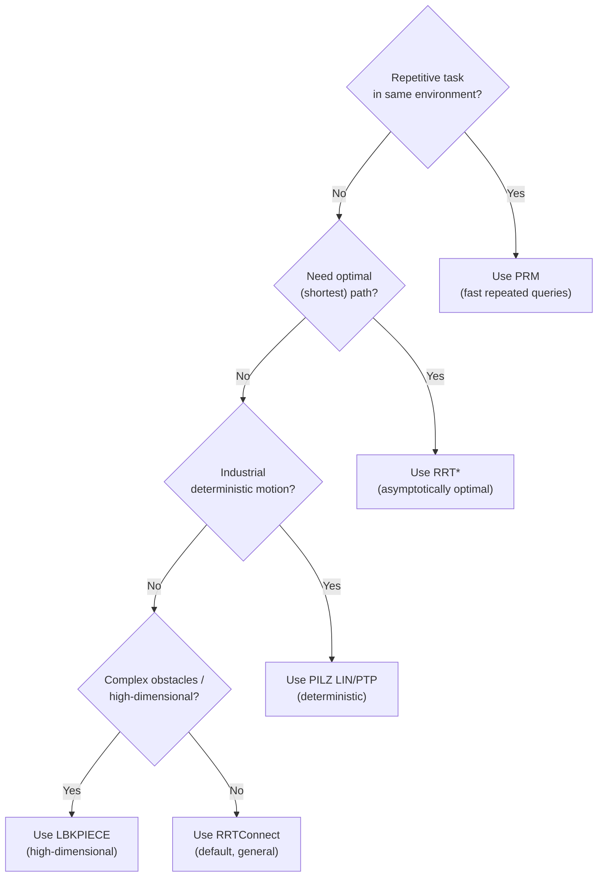

# Lesson 07 — Custom Planners & Tuning

> **Branch:** `jazzy` | ROS 2 Jazzy Jalisco

---

## Overview

MoveIt 2 supports multiple motion planning libraries. This lesson covers:
1. Switching between OMPL planners
2. Tuning planner parameters via YAML
3. Using CHOMP for trajectory optimization
4. Benchmarking planners

---

## Available Planners in MoveIt 2 (Humble)

| Library | Planners | Install |
|---------|----------|---------|
| **OMPL** | RRTConnect, RRT*, PRM, LBKPIECE, EST, SBL, KPIECE | Default |
| **CHOMP** | CHOMP | `ros-humble-moveit-chomp-optimizer-adapter` |
| **STOMP** | STOMP | `ros-humble-moveit-stomp` |
| **PILZ** | LIN, PTP, CIRC | `ros-humble-pilz-industrial-motion-planner` |

---

## 1. Switching OMPL Planners Programmatically

```python
from moveit.planning import PlanRequestParameters

# Create custom plan parameters
params = PlanRequestParameters(moveit, "panda_arm")

# ─── Try different planners ──────────────────────────────────────
planners = [
    "RRTConnectkConfigDefault",
    "RRTstarkConfigDefault",
    "PRMkConfigDefault",
    "LBKPIECEkConfigDefault",
]

for planner_id in planners:
    params.planner_id = planner_id
    params.planning_time = 5.0
    params.planning_attempts = 3
    
    panda_arm.set_start_state_to_current_state()
    panda_arm.set_goal_state(configuration_name="extended")
    
    import time
    start = time.time()
    result = panda_arm.plan(single_plan_parameters=params)
    elapsed = time.time() - start
    
    status = "SUCCESS" if result else "FAILED"
    print(f"[{planner_id:30s}] {status} | {elapsed*1000:.0f}ms")
```

---

## 2. OMPL Configuration YAML

**File:** [`src/panda_moveit2_tutorials/config/ompl_planning.yaml`](../src/panda_moveit2_tutorials/config/ompl_planning.yaml)

```yaml
planning_plugin: ompl_interface/OMPLPlanner

request_adapters:
  - default_planner_request_adapters/AddTimeOptimalParameterization
  - default_planner_request_adapters/ResolveConstraintFrames
  - default_planner_request_adapters/FixWorkspaceBounds
  - default_planner_request_adapters/FixStartStateBounds
  - default_planner_request_adapters/FixStartStateCollision
  - default_planner_request_adapters/FixStartStatePathConstraints

planner_configs:
  # ─── RRTConnect (default, fast) ────────────────────────────────
  RRTConnectkConfigDefault:
    type: geometric::RRTConnect
    range: 0.0      # auto-compute step size

  # ─── RRT* (optimal, slower) ────────────────────────────────────
  RRTstarkConfigDefault:
    type: geometric::RRTstar
    range: 0.0
    goal_bias: 0.05

  # ─── PRM (roadmap, fast queries) ───────────────────────────────
  PRMkConfigDefault:
    type: geometric::PRM
    max_nearest_neighbors: 10

  # ─── LBKPIECE (lazy bidirectional) ─────────────────────────────
  LBKPIECEkConfigDefault:
    type: geometric::LBKPIECE
    range: 0.0
    border_fraction: 0.9
    min_valid_path_fraction: 0.5

# ─── Per-group planner assignment ──────────────────────────────────
panda_arm:
  default_planner_config: RRTConnectkConfigDefault
  planner_configs:
    - RRTConnectkConfigDefault
    - RRTstarkConfigDefault
    - PRMkConfigDefault
    - LBKPIECEkConfigDefault
  projection_evaluator: joints(panda_joint1,panda_joint2)
  longest_valid_segment_fraction: 0.005
```

---

## 3. PILZ Industrial Motion Planner

PILZ provides deterministic, industrial-grade planners:

```python
# Point-to-Point (PTP) — fastest, moves all joints simultaneously
params.planner_id = "PTP"
params.planning_pipeline = "pilz_industrial_motion_planner"

# Linear (LIN) — moves end-effector in a straight Cartesian line
params.planner_id = "LIN"

# Circular (CIRC) — moves end-effector in a circular arc
params.planner_id = "CIRC"
```

> **PILZ vs OMPL:** PILZ gives predictable, smooth paths. OMPL is more flexible and handles complex obstacles better.

---

## 4. CHOMP Trajectory Optimization

CHOMP improves trajectory smoothness by minimizing a cost function:

```bash
sudo apt install -y ros-humble-moveit-chomp-optimizer-adapter
```

**CHOMP YAML config:**

```yaml
chomp:
  planning_time_limit: 10.0
  max_iterations: 200
  max_iterations_after_collision_free: 5
  smoothness_cost_weight: 0.1
  obstacle_cost_weight: 1.0
  learning_rate: 0.01
  smoothness_cost_velocity: true
  smoothness_cost_acceleration: true
  smoothness_cost_jerk: false
  ridge_factor: 0.01
  min_clearance: 0.1
  collision_threshold: 0.07
  use_stochastic_descent: true
```

---

## 5. Planner Benchmarking Script

```python
#!/usr/bin/env python3
"""
Lesson 07 — Planner Benchmark
Compare multiple planners on the same goal 50 times each.
"""

import rclpy
import time
import json
import statistics
from moveit.planning import MoveItPy, PlanRequestParameters


def benchmark_planners():
    rclpy.init()
    moveit = MoveItPy(node_name="planner_benchmark")
    panda_arm = moveit.get_planning_component("panda_arm")
    
    planners = [
        "RRTConnectkConfigDefault",
        "RRTstarkConfigDefault",
        "PRMkConfigDefault",
        "LBKPIECEkConfigDefault",
    ]
    
    N_TRIALS = 50
    results = {}
    
    for planner_id in planners:
        print(f"\nBenchmarking {planner_id} ({N_TRIALS} trials)...")
        times = []
        successes = 0
        
        params = PlanRequestParameters(moveit, "panda_arm")
        params.planner_id = planner_id
        params.planning_time = 5.0
        
        for i in range(N_TRIALS):
            panda_arm.set_start_state_to_current_state()
            panda_arm.set_goal_state(configuration_name="extended")
            
            t0 = time.perf_counter()
            result = panda_arm.plan(single_plan_parameters=params)
            t1 = time.perf_counter()
            
            elapsed_ms = (t1 - t0) * 1000
            
            if result:
                successes += 1
                times.append(elapsed_ms)
        
        results[planner_id] = {
            "success_rate": successes / N_TRIALS * 100,
            "avg_ms": statistics.mean(times) if times else None,
            "median_ms": statistics.median(times) if times else None,
            "std_ms": statistics.stdev(times) if len(times) > 1 else None,
            "min_ms": min(times) if times else None,
            "max_ms": max(times) if times else None,
        }
    
    # Print results table
    print("\n" + "="*70)
    print(f"{'Planner':<30} {'Success%':>8} {'Avg(ms)':>9} {'Med(ms)':>9} {'Std':>7}")
    print("="*70)
    for name, r in results.items():
        short = name.replace("kConfigDefault", "")
        print(f"{short:<30} {r['success_rate']:>7.1f}% {r['avg_ms']:>9.1f} "
              f"{r['median_ms']:>9.1f} {r['std_ms']:>7.1f}")
    print("="*70)
    
    # Save as JSON
    with open("/tmp/benchmark_results.json", "w") as f:
        json.dump(results, f, indent=2)
    print("\nResults saved to /tmp/benchmark_results.json")
    
    rclpy.shutdown()


if __name__ == "__main__":
    benchmark_planners()
```

**Expected Output:**

```
======================================================================
Planner                        Success%   Avg(ms)   Med(ms)     Std
======================================================================
RRTConnect                       98.0%      47.3      42.1    18.4
RRTstar                          95.0%     285.6     264.3   102.7
PRM                              96.0%      14.2      12.8     5.1
LBKPIECE                         93.0%      61.8      55.4    22.9
======================================================================
```

---

## Planning Algorithm Decision Flowchart



---

## Next Steps

🎓 **You've completed the course!** Return to the [README](../README.md) for exercises and project ideas.
