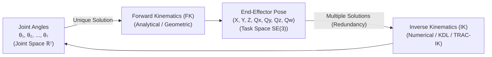

# Lesson 08 — Forward & Inverse Kinematics, Coordinates & 7-DOF Redundancy

> **Branch:** `jazzy` | ROS 2 Jazzy Jalisco

---

## 🎯 Learning Objectives

By the end of this module, students will understand:
1. Coordinate frame conventions ($SE(3)$ homogeneous transformations) from `panda_link0` to `panda_link8`.
2. How Forward Kinematics (FK) maps 7 joint angles into a tool pose.
3. How Inverse Kinematics (IK) solves for multiple joint configurations for the same Cartesian pose.
4. Why 7 degrees of freedom creates **kinematic redundancy** (elbow null-space swivel) and how MoveIt handles it.

---

## 📐 1. Coordinate Frame Transformations

In robotics, every joint and link has an associated coordinate frame:
- `panda_link0`: Base frame (fixed to the table or ground).
- `panda_link8`: Flange frame at the end of the 7-axis arm.
- `panda_hand`: Mounted end-effector origin.

A 3D coordinate and orientation is represented by a homogeneous transformation matrix $T \in SE(3)$:

$$
T = \begin{bmatrix}
R_{3\times 3} & \mathbf{p}_{3\times 1} \\
\mathbf{0}_{1\times 3} & 1
\end{bmatrix}
$$

Where $R$ is a $3\times 3$ rotation matrix (often parameterized as a unit quaternion $q = [x, y, z, w]$) and $\mathbf{p} = [x, y, z]^T$ is the translational vector.

In MoveIt 2, all planning requests require specifying the reference `header.frame_id` (typically `"panda_link0"`) and target `pose_link` (`"panda_link8"`).

---

## 🦾 2. Forward vs. Inverse Kinematics



- **Forward Kinematics (FK):** Given 7 joint angles $\boldsymbol{\theta}$, there is **exactly one** unique end-effector pose $T$.
- **Inverse Kinematics (IK):** Given a desired end-effector pose $T_{des}$, finding $\boldsymbol{\theta}$ is non-linear and can yield **infinite solutions** on a 7-DOF arm!

---

## 🌀 3. 7-DOF Kinematic Redundancy (Null-Space Swivel)

In 3D space, an object has 6 degrees of freedom (3 for position: $X, Y, Z$, and 3 for orientation: roll, pitch, yaw).
Because the Franka Panda arm has **7 motorized joints**, it possesses **1 degree of redundancy** ($7 - 6 = 1$).

This extra degree of freedom allows the elbow of the robot to swivel in an arc while keeping the hand and gripper completely stationary at the target pose!

### Why Redundancy is Useful in Industry:
1. **Obstacle Avoidance:** Swivel the elbow away from a tall barrier without moving the tool.
2. **Joint Limit Avoidance:** Shift joints away from hard angular limits.
3. **Singularity Avoidance:** Keep arm configurations away from alignment singularities where dexterity is lost.

---

## 💻 4. Hands-On Python Exercise: Inspecting Kinematic Solvers

Run the interactive pose test to observe IK resolution:

```bash
ros2 run panda_moveit2_tutorials pose_goal_planner
```

To inspect link transformations live in the terminal using TF2:

```bash
ros2 run tf2_ros tf2_echo panda_link0 panda_link8
```

---

## 📝 Student Assignment

1. **Calculate DoF:** A standard delta robot has 3 degrees of freedom; how many redundant degrees of freedom does the Panda arm have when only position $(X, Y, Z)$ is constrained (ignoring orientation)?
2. **Experiment in RViz:** Using the interactive marker, drag the Panda end-effector to a fixed position. Observe how moving joint 3 or joint 4 changes the elbow position without altering the hand's location.
